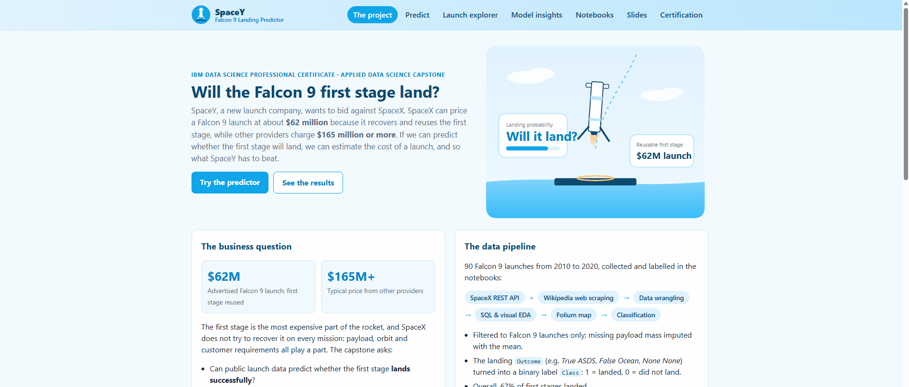

## Problem

SpaceX advertises Falcon 9 launches at **$62 million**, while competitors charge **$165 million or more**. The savings come from **recovering and reusing the first stage**. SpaceX doesn't attempt recovery on every mission—payload, orbit, and customer requirements all play a part.

*SpaceY*, a new launch company, wants to bid against SpaceX. The challenge: **Can we predict whether the first stage will land from public launch data, and estimate launch costs accordingly?**

Key questions:
1. Can public launch data predict whether the first stage lands successfully?
2. Which factors (launch site, orbit, payload, booster version, reuse) drive landing success?

## Approach

1. **Data Collection**: Collected 90 Falcon 9 launches (June 2010 – November 2020) from SpaceX REST API and Wikipedia scraping.

2. **Data Wrangling**: Kept Falcon 9 only; imputed missing payload mass with means; labeled landing outcomes (True = landed, False/None = did not land). Result: **67%** baseline landing rate.

3. **Exploratory Data Analysis**: Analyzed with SQL and visualization. Discovered that **landing legs and grid fins** (recovery hardware) are the strongest signals, followed by **flight number**. Landing success rose from 0% before 2014 to 84–90% in 2019–2020. GTO missions hardest to recover (52%); SSO, VLEO easiest.

4. **Feature Engineering**: Created one-hot encoded feature matrix (83 columns) from orbit, launch site, payload mass, booster block, reuse history, and recovery hardware indicators.

5. **Modelling**: Trained four classifiers with 10-fold GridSearchCV: Logistic Regression, SVM, Decision Tree, KNN. Test set: 18 launches; training: 72.

6. **Model Selection**: Decision Tree scored 94% on test set. For the web app, re-trained all models excluding future-leak features (Serial, LandingPad, ReusedCount) and selected **Logistic Regression** (simplest, most stable) at 83% cross-validated accuracy.

## Result

**Key Metrics Achieved:**

| Metric | Baseline | Decision Tree (Notebook) | Logistic Regression (Web App) |
|---|---|---|---|
| **Test Accuracy** | 0.67 | **0.94** | 0.83 |
| **Cross-validated Accuracy** | – | 0.88 | 0.83 |
| **Recall on Landings** | – | 1.00 | 1.00 |

**Business Impact:**
- ✅ **All four models beat the 67% baseline** by a large margin
- 🛬 **Recovery hardware is the strongest signal**: boosters with legs and grid fins land far more often
- 📈 **Flight number matters**: landing success improved from 0% to 84–90% as SpaceX gained experience
- 🛰️ **Orbit affects recovery**: GTO missions have only 52% landing rate; SSO, VLEO, ES-L1 approach 100%
- 📍 **Launch sites differ**: KSC LC 39A and VAFB SLC 4E land 77% of the time; CCAFS SLC 40 lags at 60%

**Model Characteristics:**
- Decision Tree depth-2 model is interpretable and high-performing
- Logistic Regression is simple, stable, and suitable for production
- Landing legs + grid fins + flight number are the main predictors

**Recommendation:** Deploy Logistic Regression to pricing teams for cost estimation. Use landing probability to adjust bid prices relative to SpaceX's $62M baseline. Retrain quarterly as new launch data arrives.

