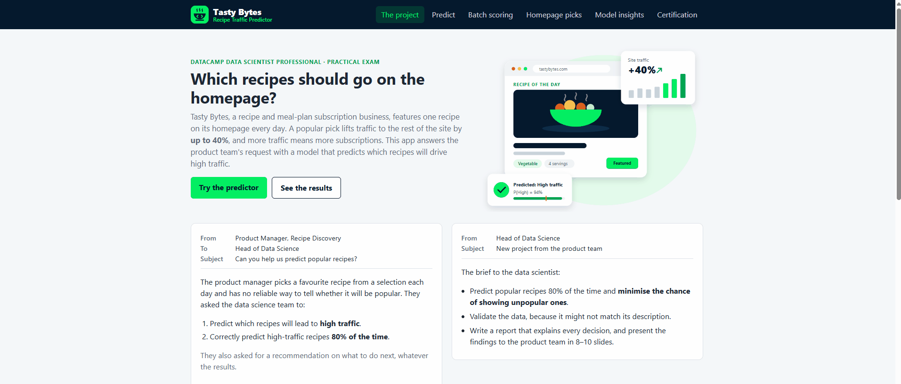

## Problem

A recipe website's product manager selects one recipe for the homepage daily based on personal preference. When the featured recipe is popular, **traffic to the rest of the site rises by up to 40%**, directly impacting subscriptions. The business challenge: **Can we predict which recipes will drive high traffic, and achieve at least 80% precision on high-traffic predictions?** The cost of failure is wasting a homepage feature day on a recipe predicted as "High" that turns out to be "Low".

## Approach

1. **Data Validation & Cleaning**: Processed 947 recipes across 8 features. Handled text-encoded servings, merged undocumented categories, imputed missing nutrition values with category medians, and labeled unlabeled recipes as "Low" traffic (only high-traffic recipes are labeled in the dataset).

2. **Exploratory Data Analysis**: Discovered that recipe category is the strongest traffic signal—Vegetable (99%), Potato (94%), and Pork (92%) recipes are almost always high-traffic, while Beverages, Breakfast, and Chicken fall far below the 61% average. Nutrition distributions overlap heavily between high and low-traffic recipes.

3. **Modelling**: Trained four models (Logistic Regression, Random Forest, Gradient Boosting, XGBoost) plus a dummy baseline using stratified 80/20 train/test split and 5-fold stratified cross-validation. Selected Logistic Regression for its simplicity and strong performance.

4. **Threshold Optimization**: Tuned the decision threshold on out-of-fold training predictions to achieve ≥80% precision while maximizing recall. Moved threshold from 0.50 to 0.63 to balance business needs.

5. **Test Evaluation**: Evaluated on unseen test data to ensure no overfitting. Tracked precision, recall, ROC-AUC, and homepage hit rate.

## Result

**Key Metrics Achieved:**

| Metric | Baseline (Random Pick) | Logistic Regression |
|---|---|---|
| **Precision (Homepage Hit Rate)** | 0.61 | **0.90** (95% CI: 0.83–0.96) ✅ |
| **Test ROC-AUC** | 0.50 | **0.87** |
| **Wasted Homepage Days (Test Set)** | – | **16 → 8** at threshold 0.63 |

**Business Impact:**
- ✅ **80% precision target met** on unseen test data
- 📈 **Homepage hit rate improves from ~61% to ~90%**, yielding ~9 additional high-traffic days per month
- 🥦 **Recipe category dominates** as a predictor; nutrition and servings have minimal impact
- 🎯 Top 30 model-ranked recipes achieved **100%** high-traffic rate vs. 61% random selection

**Model Characteristics:**
- Simple, interpretable Logistic Regression selected over complex alternatives
- Category coefficients are the primary drivers of predictions
- Missing nutrition imputed per category maintains data integrity

**Recommendation:** Implement the model as a decision aid, selecting homepage recipes from candidates above the 0.63 probability threshold, ranked by predicted probability. Conduct a 4–6 week A/B test to validate against manual selection.
